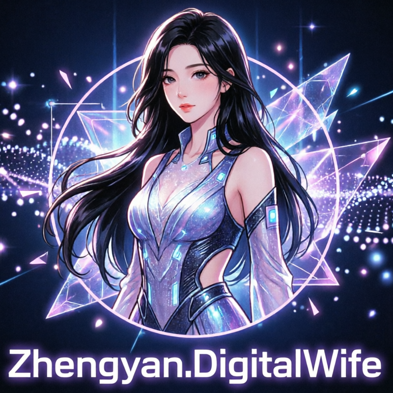

# Zhengyan.DigitalWife

**一个用 C# / .NET 开发的轻量游戏引擎与制作工具，面向 MMD 场景、互动角色和 AI 数字人应用。**

项目包含可视化编辑器、桌面播放器、Android 播放器，以及可以单独使用的渲染、动画、音频和 AI 模块。你可以先制作一个普通的互动场景，再按需要加入角色说话、语音对话、长期记忆或桌面精灵。

项目仍在持续开发。PC 与 Android 共用部分场景和渲染代码，但平台输入、音频、窗口能力和显卡表现存在差异；发布前需要在目标设备上测试。

阅读导航：[选择入口](#先选一个入口) · [从源码开始](#从源码开始) · [平台差异](#pc-与-android-的主要区别) · [语音与 AI](#语音与-ai-如何接入) · [子项目地图](#子项目地图) · [常见问题](#遇到问题先看这里)

## 先选一个入口

| 你想做什么 | 从哪里开始 |
| --- | --- |
| 制作场景、交互和游戏 | [GameEditor 编辑器](src/Zhengyan.DigitalWife.GameEditor/README.md) |
| 运行别人制作的工程或游戏包 | [PC GamePlayer](src/Zhengyan.DigitalWife.GamePlayer/README.md) / [Android GamePlayer](src/Zhengyan.DigitalWife.GamePlayer.Android/README.md) |
| 学习 C# 引擎代码，先看角色动起来 | [MmdQuickStart](samples/Zhengyan.DigitalWife.Samples.MmdQuickStart/README.md) |
| 调试模型、动作、口型和特效 | [MmdDemo](samples/Zhengyan.DigitalWife.Samples.MmdDemo/README.md) |
| 给角色接入语音和 AI | [语音能力说明](#语音与-ai-如何接入) / [RealtimeVoice 服务](samples/Zhengyan.DigitalWife.Samples.RealtimeVoice/README.md) |
| 扩展引擎或单独使用某个模块 | [子项目地图](#子项目地图) |

**只运行游戏时不需要安装整个开发环境。** 如果拿到的是已发布的 PC 播放器或 Android APK，按对应播放器说明安装，随后打开游戏包即可。下面的步骤适用于从源码编译的人。

## 项目能做什么

| 能力 | 可以制作的内容 |
| --- | --- |
| 场景与工程 | 多场景切换、加载界面、角色和场景资源管理 |
| MMD 角色 | PMX 模型、VMD 动作、动作混合、骨骼、Morph 表情、IK、角色与服装绑定、PMX 物理 |
| 画面 | OpenGL / Vulkan、天空盒、灯光和阴影、粒子、水面、镜面反射、多相机、Render Texture、自定义 shader |
| 游戏交互 | C# 脚本、PC Python 脚本、键鼠、手柄、原生多点触摸、GUI、对话气泡、存档、网络 |
| 碰撞与导航 | Box / Capsule / Mesh Collider、射线拾取、地面采样、NavMesh 烘焙与路径查询 |
| AI 角色 | 文本对话、流式回复、TTS、语音识别、唤醒词、工具调用、项目 Skills、长期记忆 |
| 发布 | 工程目录运行、`.dwgame` 打包、加密、分包、PC / Android C# 脚本预编译 |
| 桌面精灵 | 透明窗口、点击穿透、拖动、系统托盘；属于桌面平台能力 |

这里的场景 Collider / 地面采样与 PMX 模型内部的 Bullet 刚体物理用途不同。水面波纹是视觉交互，不是完整流体模拟。完整属性和使用示例见[脚本 API](src/Zhengyan.DigitalWife.GameEditor/script_api.html)。

## 新手需要知道的几个词

- **引擎**：负责显示画面、更新动作、处理输入、音频和游戏逻辑的代码。
- **编辑器 GameEditor**：用界面布置场景、配置资源和绑定脚本。
- **播放器 GamePlayer**：读取制作好的工程并运行；游戏逻辑来自工程中的脚本。
- **工程目录**：保存 `game.project.json`、场景、资源和脚本的文件夹，适合开发修改。
- **游戏包 `.dwgame`**：把工程打包后得到的文件。它是游戏内容，需要配合播放器运行，不是 EXE 或 APK。
- **PMX / VMD**：MMD 模型文件 / 动作文件。导入 PMX 时要连同模型贴图一起保留。
- **脚本**：控制角色移动、按钮事件、对话流程等。C# 使用 `.csx`，Python 使用 `.py`。

## 从源码开始

### 1. 准备环境

安装 **.NET 10 SDK**、Git，以及能编辑 C# 的工具，例如 Visual Studio、Rider 或 VS Code。SDK 包含编译工具；只安装 .NET Runtime 不能构建项目。

把整个仓库下载或克隆到本机。在仓库根目录打开终端，确认能看到 `README.md` 和 `src/`：

```text
dotnet --list-sdks
dotnet --info
```

SDK 列表应包含 `10.x`。当前项目目标框架是 `net10.0`，Android 是 `net10.0-android`。`global.json` 保留了旧的 SDK 起点并允许向更高主版本滚动；这不表示 .NET 9 就能编译当前代码。

先体验 3D 场景不需要下载语音模型，也不需要 AI 服务或 API Key。Python 只在使用 Python 脚本时需要。Android 的 SDK、JDK 和 workload 只在编译 Android 时需要，见[Android 安装指南](src/Zhengyan.DigitalWife.GamePlayer.Android/README.md)。

### 2. 启动编辑器

以下命令均在仓库根目录执行。首次运行会还原 NuGet 依赖，需要网络，耗时通常比后续启动长。

```text
dotnet run --project src/Zhengyan.DigitalWife.GameEditor
```

预期结果：出现编辑器窗口和场景预览。建议在 Project 面板中选择自己的工程目录，不要长期把作品放在 `bin/` 构建输出目录里。

### 3. 制作并运行第一个工程

1. 在 Project 面板选择目录，点击 `Use Directory`，再创建或加载工程。
2. 导入一个 PMX 模型和 VMD 动作；调整位置、相机和灯光。
3. 保存工程，记下保存目录。
4. 用 PC 播放器运行这个目录。

下面的路径是示例，需替换成自己的工程目录；路径有空格时保留引号：

```text
dotnet run --project src/Zhengyan.DigitalWife.GamePlayer -- "D:/Games/MyFirstGame"
```

更多操作见[编辑器入门](src/Zhengyan.DigitalWife.GameEditor/README.md)。想直接体验内置素材，也可先运行：

```text
dotnet run --project samples/Zhengyan.DigitalWife.Samples.MmdQuickStart
```

### 4. 加入脚本与发布

从一个简单的 C# 更新脚本开始，例如让角色缓慢旋转：

```csharp
if (IsUpdate)
{
    Entity.RotateY(20.0f * (float)DeltaSeconds);
}
```

把脚本绑定到实体后，在 GamePlayer 中验证。打开[可检索脚本文档](src/Zhengyan.DigitalWife.GameEditor/script_api.html)，搜索 `Entity`、`TouchTransitions` 或 `PlatformName` 获取示例。

验证工程后，在编辑器 `Project -> Package / Publish` 导出 `.dwgame`。Android 发布前点击 `Check Android Compatibility`，处理错误和警告，并保留对应的 C# 预编译选项。

```text
dotnet run --project src/Zhengyan.DigitalWife.GamePlayer -- "D:/Games/MyFirstGame.dwgame"
```

手机上安装 Android 播放器，再通过文件选择器打开同一个包。使用新脚本 API 时，应一起更新编辑器和播放器，并重新导出游戏包。

## PC 与 Android 的主要区别

| 项目 | PC | Android |
| --- | --- | --- |
| 播放器 | Windows / Linux / macOS 桌面程序 | 原生 APK，最低目标系统为 Android 7.0 / API 24 |
| 渲染 | OpenGL / Vulkan，取决于驱动与平台 | OpenGL ES / Vulkan，Auto 模式尝试 Vulkan 后可回退 GLES |
| C# 脚本 | 支持 | 支持，使用独立的 Android 预编译契约 |
| Python 脚本 | 需要本机 Python | 不支持 |
| Touch | Windows 原生指针、Linux/X11、macOS Cocoa；macOS 主要是触控板 | 原生 MotionEvent，多指与触控笔 |
| ASR / TTS | 工程配置的 Whisper / Sherpa 等本地能力 | 系统语音识别和 TTS 服务；系统识别器可能依赖网络 |
| RealtimeVoice | 服务端处理语音，PC 负责采音和播放 | 使用同一服务协议，Android 原生采音和播放 |
| 桌面精灵 / 托盘 | 平台实现；Linux 点击穿透需要 X11 | 不支持桌面窗口功能 |
| GPU 蒙皮 | OpenGL 可选 OpenCL；Vulkan 可选 Compute | 不启用 OpenCL；Vulkan 可选 Compute，失败可回退 CPU |

同一包可以跨平台加载，不代表每个功能在所有平台表现完全相同。Wayland Touch 暂未接入；Android 音频路由、软键盘、自定义 shader 和 GPU 性能需要真机验证。当前实现范围见[Android 能力对照](docs/android-render-parity.md)。

## 语音与 AI 如何接入

ASR 是“语音转文字”，LLM 是“生成回复”，TTS 是“文字转语音”。普通场景运行无需开启这些功能。

**路线 A：在游戏工程中分别配置。** 在编辑器配置 ASR、LLM、Voice / TTS，然后用 `Scene.Asr`、`Scene.Llm`、`Entity.Speak` 编排对话。PC 的本地语音需要模型文件；LLM 地址、密钥和模型名称由你提供。

**路线 B：连接 RealtimeVoice 服务。** 在另一进程或机器上运行[语音服务示例](samples/Zhengyan.DigitalWife.Samples.RealtimeVoice/README.md)，由它处理 ASR、LLM 和 TTS。播放器通过 `Scene.RealtimeVoice` 上传录音并播放回复，适合把较重的推理移到服务器。可以先用[DigitalHuman 示例](samples/Zhengyan.DigitalWife.Samples.DigitalHuman/README.md)验证这条链路。

模型下载入口：

```powershell
./scripts/download-models.ps1
```

Linux / macOS：

```bash
bash scripts/download-models.sh
```

权重下载到 `models/`，压缩包缓存到 `artifacts/downloads/`。只做 3D 场景时可以跳过；这些脚本下载语音模型，不会部署 LLM。模型名称和文件布局应与实际配置一致。

Skills 和记忆是两组独立可选能力。游戏项目的 `skills/` 保存工具说明和资源，玩家存档目录下的 `memory/` 保存长期记忆。启用命令工具后，工具会按当前进程权限执行；只对可信的工程开启。发布前检查游戏包是否包含服务密钥或个人存档。

## Linux 运行依赖

以下是 Debian / Ubuntu 系发行版的安装示例；其它发行版请使用对应包管理器，个别包名可能不同。

```bash
sudo apt update
sudo apt install -y libopenal1 libportaudio2 libsndfile1 ca-certificates
sudo apt install -y libgl1-mesa-dri libegl1 libgles2 libx11-6 libxi6 libxcursor1 libxinerama1 libxrandr2 libxxf86vm1 libfontconfig1 fonts-noto-cjk
```

使用 Python 脚本再安装 `python3`。使用 Vulkan 需要可用的 Vulkan 驱动；支持 OpenGL 的机器不一定支持 Vulkan。

麦克风排查先验证系统能录音，再查看 PortAudio 设备索引。硬件特定案例见[Linux 内置麦克风记录](docs/linux-mint-lenovo-e41-80-microphone.md)，该文档中的驱动参数不适用于所有设备。

## 子项目地图

库项目不能用 `dotnet run` 启动，通常由编辑器、播放器或示例引用。每个入口都有独立 README。

| 分组 | 子项目与职责 |
| --- | --- |
| 制作与运行 | [GameEditor](src/Zhengyan.DigitalWife.GameEditor/README.md)、[PC GamePlayer](src/Zhengyan.DigitalWife.GamePlayer/README.md)、[Android GamePlayer](src/Zhengyan.DigitalWife.GamePlayer.Android/README.md) |
| 工程格式 | [GameProjects](src/Zhengyan.DigitalWife.GameProjects/README.md)、[GameProjects.Core](src/Zhengyan.DigitalWife.GameProjects.Core/README.md) |
| 共享运行时 | [GamePlayer.Runtime.Core](src/Zhengyan.DigitalWife.GamePlayer.Runtime.Core/README.md)、[Android.Scripting](src/Zhengyan.DigitalWife.GamePlayer.Android.Scripting/README.md) |
| MMD 与渲染 | [Mmd](src/Zhengyan.DigitalWife.Mmd/README.md)、[Mmd.Core](src/Zhengyan.DigitalWife.Mmd.Core/README.md)、[Mmd.Game](src/Zhengyan.DigitalWife.Mmd.Game/README.md) |
| AI 与语音 | [Abstractions](src/Zhengyan.DigitalWife.Abstractions/README.md)、[Assistant](src/Zhengyan.DigitalWife.Assistant/README.md)、[Llm.OpenAI](src/Zhengyan.DigitalWife.Llm.OpenAI/README.md)、[SherpaOnnx](src/Zhengyan.DigitalWife.Speech.SherpaOnnx/README.md)、[WhisperNet](src/Zhengyan.DigitalWife.Speech.WhisperNet/README.md) |
| 音频与协议 | [PortAudio](src/Zhengyan.DigitalWife.Audio.PortAudio/README.md)、[OpenAL](src/Zhengyan.DigitalWife.Audio.OpenAL/README.md)、[Realtime.OpenAI](src/Zhengyan.DigitalWife.Realtime.OpenAI/README.md)、[RealtimeVoice.Client](src/Zhengyan.DigitalWife.RealtimeVoice.Client/README.md) |
| 示例 | [AssistantConsole](samples/Zhengyan.DigitalWife.Samples.AssistantConsole/README.md)、[RealtimeVoice](samples/Zhengyan.DigitalWife.Samples.RealtimeVoice/README.md)、[DigitalHuman](samples/Zhengyan.DigitalWife.Samples.DigitalHuman/README.md)、[MmdQuickStart](samples/Zhengyan.DigitalWife.Samples.MmdQuickStart/README.md)、[MmdDemo](samples/Zhengyan.DigitalWife.Samples.MmdDemo/README.md) |
| 工具 | [ModelInstaller](tools/Zhengyan.DigitalWife.Tools.ModelInstaller/README.md)、[ModelInspector](tools/Zhengyan.DigitalWife.Tools.ModelInspector/README.md)、[ApiInspector](tools/Zhengyan.DigitalWife.Tools.ApiInspector/README.md)、[Android Veldrid 补丁](tools/VeldridAndroidPatch/README.md)、[桌面 Veldrid 补丁](tools/VeldridTransparentSwapchainPatch/README.md) |
| 回归验证 | [GameEditor.Tests](tests/Zhengyan.DigitalWife.GameEditor.Tests/README.md)、[AndroidRuntime.Tests](tests/Zhengyan.DigitalWife.AndroidRuntime.Tests/README.md)、[PmxParity.Tests](tests/Zhengyan.DigitalWife.PmxParity.Tests/README.md) |

```text
src/       编辑器、播放器和可复用库
samples/   可运行示例
tests/     回归验证程序
tools/     模型与渲染维护工具
scripts/   下载模型、清理构建的辅助脚本
assets/    引擎内置资源与示例素材
docs/      架构、渲染和故障排查记录
models/    本地下载的模型权重，不随 Git 提交
artifacts/ 本机构建和下载产物，不随 Git 提交
```

## 开发者构建与验证

先构建所需入口即可；需要检查桌面工具链时再构建桌面解决方案。Android 使用独立解决方案，需要额外环境。

```text
dotnet build Zhengyan.DigitalWife.slnx
dotnet run --project tests/Zhengyan.DigitalWife.GameEditor.Tests
dotnet run --project tests/Zhengyan.DigitalWife.AndroidRuntime.Tests
dotnet run --project tests/Zhengyan.DigitalWife.PmxParity.Tests
```

这些测试项目当前是可执行回归程序，请用 `dotnet run`。部分测试需要图形设备、Python 或原生库；桌面回归通过不等于 Android 真机表现已验证。

## 遇到问题先看这里

| 现象 | 先检查 |
| --- | --- |
| 找不到 `dotnet`、无法编译 `net10.0` | 是否安装 .NET 10 **SDK**，重开终端后检查版本 |
| NuGet 还原失败 | 网络、代理、证书与源配置；不要直接用 `--no-restore` 绕过失败 |
| 找不到工程 | 参数应指向包含 `game.project.json` 的目录，或正确的 `.dwgame` 文件 |
| 模型没贴图 | PMX 与贴图是否一起导入，资源是否已保存为工程相对路径 |
| 黑屏、Vulkan 初始化失败 | 查看启动日志，更新显卡驱动，尝试 `--graphics-backend OpenGL` |
| 第一次对话没声音 | 是否开启 TTS，模型路径、麦克风/扬声器权限和服务地址是否正确 |
| Android ASR 网络超时 | 系统识别服务可能连接网络；后台监听恢复不代表远端连接已修复 |
| 手机访问不到电脑语音服务 | 手机的 `127.0.0.1` 指手机自己；使用电脑局域网 IP 或 USB `adb reverse` |
| 新脚本 API 在旧包中不可用 | 同时更新编辑器与播放器，重新导出使用新 API 的包 |

反馈问题时，请带上系统/设备、使用的渲染后端、复现步骤和完整错误日志，并隐去密钥。

## 文档与素材

- [脚本 API 检索](src/Zhengyan.DigitalWife.GameEditor/script_api.html)与[Markdown 索引](src/Zhengyan.DigitalWife.GameEditor/script_api.md)。
- [渲染后端设计](docs/rendering-backends.md)、[Android 当前能力](docs/android-render-parity.md)。
- [Android 架构与历史开发计划](docs/android-gameplayer.md)：包含早期审计，不应把历史缺项当成当前状态。
- [引擎资源](assets/mmd/engine/Resources/README.md)、[天空盒来源](assets/mmd/engine/Resources/Skybox/README.md)。

示例模型、动作、音乐、贴图和第三方库的授权各自独立。使用或分发作品前确认所用素材的授权，不能从引擎可运行推断素材可自由商用。
