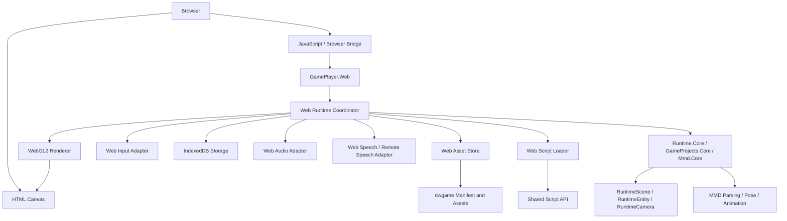

# Web Runtime 设计方案、实现边界与实施计划

> 文档状态：设计讨论稿
>
> 创建日期：2026-10-30
>
> 当前状态：阶段 0、阶段 1、阶段 2、阶段 3、阶段 4、阶段 5、阶段 6、阶段 7、阶段 8 和阶段 9 已实现；真正的 WebGPU renderer 和后续高级服务仍可增量开发。
>
> 适用项目：`Zhengyan.DigitalWife`
>
> 目标读者：后续继续实现本方案的开发者、维护者，以及需要从中断会话快速恢复上下文的协作者。

## 1. 决策摘要

本项目支持 Web 端是可行的，但 Web 应被视为一个独立的运行时目标，而不是在 PC 和 Android 项目上简单增加一个编译目标。

当前最适合的总体方向是：

1. 保留现有场景模型、实体系统、相机、动画、PMX/VMD 解析、脚本 API 的跨平台部分。
2. 新增 `GamePlayer.Web` 宿主项目，以浏览器 Canvas 和 WebAssembly 为运行环境。
3. 以 WebGL2 作为第一阶段渲染后端，保留以后增加 WebGPU 后端的接口空间。
4. 脚本在 GameEditor 导出阶段预编译成 Web 兼容程序集，Web 运行时只加载程序集，不在浏览器中运行 Roslyn 编译 `.csx`。
5. 把文件系统、存档、音频、语音、输入、网络和脚本加载都抽象成平台服务。
6. 第一阶段以“网页中加载并运行一个完整场景”为目标，先保证模型、动画、相机、输入和基础音频可用，再逐步补齐高级渲染、语音和 AI 能力。

最重要的边界是：

- 预编译的纯托管脚本 DLL 可以作为 Web 脚本方案。
- 依赖桌面/Android 原生库的 DLL 不能直接放到 Web 端使用。
- 当前 `.dwgame` 的本地文件解包、临时目录和缓存逻辑不能原样搬到浏览器。
- 当前 Veldrid 官方后端列表没有浏览器 WebGL/WebGPU 后端，因此不能只修改目标框架就得到 Web 版渲染器。
- Web 端要先定义功能分级，不能一开始承诺和桌面端完全同等的原生能力。

## 2. 为什么现在适合开始做 Web 支持

项目已经有几个有利条件。

### 2.1 场景运行时已经有平台无关核心

以下项目当前以 `net10.0` 为目标，并且承载了较多可以复用的逻辑：

- `src/Zhengyan.DigitalWife.GamePlayer.Runtime.Core`
- `src/Zhengyan.DigitalWife.GameProjects.Core`
- `src/Zhengyan.DigitalWife.Mmd.Core`

`RuntimeScene`、`RuntimeEntity`、`RuntimeCamera`、场景动画控制、相机输入数据结构、项目 JSON 模型和部分碰撞/物理逻辑不需要依赖窗口系统。

`PmxPoseEvaluator` 还包含托管的轻量物理 fallback。Web 第一阶段可以先依赖这一实现，而不必立刻把 Android/桌面使用的原生 Bullet 路径移植到 WebAssembly。

### 2.2 渲染层已经有后端边界

`src/Zhengyan.DigitalWife.Mmd.Game/Graphics` 已经包含：

- `IRenderer`
- `IRendererFactory`
- `IRenderBackendServices`
- `IRenderTarget`
- `ITexture2D`
- PMX 主渲染和辅助渲染接口
- OpenGL 后端
- Veldrid/Vulkan 后端

这说明项目已经从“各个组件直接持有 OpenGL 对象”逐步迁移到“组件依赖渲染抽象”。这对增加 Web 后端非常有利。

但 Web 端仍然需要新的浏览器渲染实现。当前 `OpenGlRenderer` 依赖 `Silk.NET.Windowing.IWindow` 和原生 OpenGL ES 上下文，不能直接在浏览器中创建窗口；浏览器需要把渲染目标绑定到 HTML Canvas。

### 2.3 桌面端已经存在预编译脚本路径

`src/Zhengyan.DigitalWife.GamePlayer/CSharpScriptInstance.cs` 当前会尝试加载：

```text
compiled/desktop/<script>.dll
```

并通过 `Assembly.Load(File.ReadAllBytes(...))` 找到脚本程序集中的工厂方法。这个机制可以作为 Web 端“导出时编译、运行时执行”的原型基础。

Android 侧也已经有独立的 `AndroidScriptCompiler` 和预编译脚本兼容处理。这说明脚本编译和运行时加载已经被当作平台边界处理，而不是完全绑定在 Editor 内部。

## 3. 参考资料与外部约束

Web 端方案需要遵循浏览器和 .NET WebAssembly 的运行模型：

- [Microsoft：Blazor hosting models](https://learn.microsoft.com/en-us/aspnet/core/blazor/hosting-models)
- [Microsoft：Lazy load assemblies in Blazor WebAssembly](https://learn.microsoft.com/en-us/aspnet/core/blazor/webassembly-lazy-load-assemblies?view=aspnetcore-10.0)
- [Microsoft：Blazor WebAssembly build tools and AOT](https://learn.microsoft.com/en-us/aspnet/core/blazor/webassembly-build-tools-and-aot?view=aspnetcore-10.0)
- [Veldrid 官方仓库](https://github.com/mellinoe/veldrid)
- [WebGPU 规范](https://gpuweb.github.io/gpuweb/)

这些资料支持几个设计判断：

1. .NET 代码可以作为浏览器中的 WebAssembly 应用运行。
2. WebAssembly 应用可以按需下载和加载托管程序集，但程序集及其依赖必须被正确发布、发现和保留。
3. WebAssembly 发布的裁剪和 AOT 会影响程序集反射、发布体积和启动时间。
4. Veldrid 当前官方后端列表主要面向桌面和移动图形 API，不能假定已经有可直接使用的浏览器后端。
5. WebGPU 可以作为未来的高性能后端，但需要能力检测和独立的浏览器资源绑定。

## 4. 目标与非目标

### 4.1 第一阶段目标

第一阶段目标是让一个 Web 页面能够：

- 初始化 WebAssembly 游戏运行时。
- 创建和调整 HTML Canvas 渲染表面。
- 加载一个 Web 版游戏包或静态项目目录。
- 读取项目配置、场景、模型、动作、纹理和材质资源。
- 显示至少一个 PMX 模型。
- 播放 VMD 动画、控制相机和场景时间。
- 支持键盘、鼠标、触摸和 Pointer Events 的基础输入。
- 执行预编译 Web 脚本程序集。
- 播放基础背景音乐和音效。
- 保存最基本的游戏状态。
- 在浏览器中显示加载进度、错误信息和运行时诊断。

### 4.2 后续目标

后续可以逐步增加：

- 完整 PMX 材质、阴影、边缘、反射、水面、粒子和后处理。
- Web 端 GUI 和对话气泡。
- IndexedDB 存档、离线缓存和 Service Worker。
- 浏览器 TTS、浏览器麦克风输入、服务器 ASR/TTS。
- WebSocket/WebRTC 实时语音。
- WebGPU 后端。
- 更完整的导航、物理和调试工具。
- Web 版 GameEditor 或独立的在线预览器。

### 4.3 第一阶段明确不承诺

以下能力不属于 Web 第一阶段的必需验收项：

- 在浏览器中动态编译任意 `.csx`。
- 直接运行 Python 脚本。
- 直接加载 PortAudio、SherpaOnnx、Whisper.net 等桌面/Android 原生库。
- 访问用户电脑任意本地路径。
- 使用桌面透明窗口、系统托盘、窗口穿透和原生剪贴板扩展。
- 在没有服务端支持的情况下保证本地 ASR、TTS 和实时语音完全等同于 Android。
- 直接复用 Vulkan 后端。
- 让 Web 版本自动拥有桌面端所有第三方原生依赖。

## 5. 建议的总体架构



核心原则是：

- 场景和游戏逻辑不直接访问浏览器 API。
- 浏览器 API 只出现在 Web 宿主或 Web 平台适配层。
- 脚本只依赖稳定的游戏脚本 API，不依赖桌面 GamePlayer 主程序。
- 渲染器负责 GPU 资源，场景组件只依赖渲染抽象。
- 资源访问通过统一异步接口进行，避免让场景逻辑知道资源来自文件、APK、HTTP 还是内存包。

## 6. 推荐的项目拆分

以下是建议的新增项目名称，名称可以在实现阶段调整：

```text
src/
  Zhengyan.DigitalWife.GamePlayer.Web/
    Web host、Blazor/WASM 启动、Canvas、生命周期、错误页面

  Zhengyan.DigitalWife.GamePlayer.Web.Rendering/
    WebGL2 renderer、Canvas context、Web shader、GPU resource adapter

  Zhengyan.DigitalWife.GamePlayer.Web.Scripting/
    Web script manifest、程序集加载、脚本实例创建、兼容性诊断

  Zhengyan.DigitalWife.GamePlayer.Web.Browser/
    JavaScript interop、输入、音频、存储、网络、文件选择器

  Zhengyan.DigitalWife.GamePlayer.ScriptApi/
    跨平台脚本接口、ScriptContext、事件模型、能力声明
```

实际拆分时可以先合并成一个 `GamePlayer.Web` 项目，等 Web 运行时稳定后再按依赖边界拆开。第一阶段不应为了项目数量而过早拆分。

已有项目建议保持不变或尽量不引用 Web API：

```text
GamePlayer.Runtime.Core
GameProjects.Core
Mmd.Core
GameProjects
Mmd.Game
```

如果 `Mmd.Game` 中仍存在直接依赖 `Silk.NET.Windowing`、原生 OpenGL 或桌面窗口对象的公共 API，应逐步把这些依赖收回到后端实现内部。

## 7. 渲染后端设计

### 7.1 第一阶段使用 WebGL2

第一阶段建议实现 `WebGl2Renderer`，而不是尝试把桌面 `OpenGlRenderer` 原样放进浏览器。

原因：

- 当前 OpenGL 后端已经使用 OpenGL ES 3.0 风格的资源和 shader 思路。
- WebGL2 的上下文属于 Canvas，不属于 Silk.NET 的原生窗口对象。
- 浏览器上下文创建、帧循环、尺寸变化和事件处理需要 JavaScript/浏览器宿主配合。
- 现有 `IRenderer` 和各类 pass 接口可以继续作为上层边界。

建议的初始化流程：

```text
Web page loads
  -> create canvas
  -> request WebGL2 context
  -> create WebGL resource bridge
  -> create WebGl2Renderer
  -> initialize shared GamePlayer runtime
  -> start requestAnimationFrame loop
```

`WebGl2Renderer` 需要负责：

- Canvas framebuffer 的绑定和清理。
- viewport、scissor、resize 和 device pixel ratio。
- shader 编译、链接和错误日志。
- vertex/index/uniform buffer。
- texture、sampler、framebuffer、depth texture。
- render target 和屏幕恢复。
- readback 能力的可选实现。
- GPU 资源释放。
- WebGL context lost/restored 的恢复策略。

### 7.2 Shader 和材质边界

当前项目同时存在 OpenGL GLSL 和 Vulkan SPIR-V 路径。WebGL2 初期不应假定 SPIR-V 可以直接使用。建议：

- 为 WebGL2 保留 GLSL ES 3.00 版本的 shader。
- 把 shader 的公共参数布局写成后端无关的材质描述。
- 为 PMX 主 pass、边缘 pass、阴影 pass 先提供 WebGL2 实现。
- 水面、后处理、复杂粒子和多重反射可以先作为能力开关。
- shader 编译失败时记录 shader 名称、材质名、版本和完整日志。

建议把渲染功能按能力分级：

```text
WebGL2-Baseline
  PMX 基础材质、纹理、动画、相机、深度测试、透明、基础灯光

WebGL2-Extended
  阴影、边缘、天空盒、粒子、屏幕 Sprite、RenderTexture

WebGL2-Optional
  水面、平面反射、后处理、复杂自定义 shader

WebGPU-Future
  更现代的资源绑定、计算能力和高质量后处理
```

### 7.3 WebGPU 预留

WebGPU 不应在第一阶段阻塞 WebGL2。可以保留以下接口：

- `IRendererFactory`
- `IRenderBackendServices`
- `ITexture2D`
- `IGpuBuffer`
- `IRenderTarget`
- 各类 pass renderer 接口

只要这些接口不暴露 OpenGL 或 Vulkan 的具体句柄，后续可以增加 `WebGpuRenderer`。

### 7.4 首个渲染验收顺序

1. 纯色 Canvas 和 viewport resize。
2. 一个三角形或简单 textured quad。
3. 一个静态 PMX 模型。
4. PMX 纹理、材质、透明和深度。
5. VMD 动画、骨骼和 morph。
6. 多模型、灯光、阴影和屏幕 Sprite。
7. RenderTexture、反射、水面和后处理。

不应直接从完整 DemoGame04 开始排查渲染后端。每一步都要有最小场景，方便区分 GPU、资源和脚本问题。

## 8. 资源与 `.dwgame` 包设计

### 8.1 现有实现的问题

`GameProjectPackage` 当前大量使用：

- `File.OpenRead`
- `File.Create`
- `Directory.CreateDirectory`
- `Directory.Move`
- 临时目录
- 本地持久化缓存
- 通过路径拼接解析项目资源

这些逻辑适用于 PC 和 Android 的应用沙盒，但不适用于浏览器任意路径访问。

### 8.2 统一资源接口

建议增加一个平台无关的异步资源接口，名称可以调整：

```csharp
public interface IGameAssetStore
{
    ValueTask<bool> ExistsAsync(string relativePath, CancellationToken cancellationToken = default);
    ValueTask<Stream> OpenReadAsync(string relativePath, CancellationToken cancellationToken = default);
    ValueTask<byte[]> ReadAllBytesAsync(string relativePath, CancellationToken cancellationToken = default);
    ValueTask<string> GetUriAsync(string relativePath, CancellationToken cancellationToken = default);
}
```

建议实现：

```text
FileSystemAssetStore     PC
AndroidAssetStore        Android APK/应用缓存
HttpAssetStore           Web 静态资源或服务器资源
MemoryAssetStore         已下载 dwgame 包、测试和离线资源
```

场景加载、纹理加载、音频加载和脚本加载都应通过这个接口，而不是自己调用 `File.*`。

### 8.3 Web 包的两种发行形态

#### 形态 A：静态目录发布

```text
web-game/
  game.project.json
  web.manifest.json
  scenes/
  assets/
  scripts/
  compiled/web/
```

优点：

- 浏览器可以直接按 URI 加载资源。
- 支持缓存、CDN 和增量更新。
- 初期更容易定位资源错误。
- 不需要先在内存中解压完整包。

缺点：

- 资源文件暴露为多个请求。
- 需要处理缓存策略和跨域配置。

#### 形态 B：单个 `.dwgame` 包

浏览器先下载包，再由 WebAssembly 在内存中解析、解密、解压并通过 `MemoryAssetStore` 提供资源。

优点：

- 与现有导出形式更接近。
- 可以继续使用包版本、哈希、签名和资源清单。

缺点：

- 首次加载需要等待完整包。
- 大型 PMX、纹理和音频会占用较多内存。
- 需要重写当前依赖临时目录的解包逻辑。

建议先支持形态 A，再增加形态 B。两种形态都使用同一个 `IGameAssetStore`，避免场景层产生分支。

### 8.4 建议的 Web 清单

可以在现有项目配置旁边增加逻辑清单：

```json
{
  "formatVersion": 1,
  "runtime": "web",
  "renderer": "webgl2",
  "apiVersion": "1.0",
  "entryScene": "scenes/Main.scene.json",
  "scripts": [
    {
      "id": "body",
      "assembly": "compiled/web/Body.dll",
      "type": "Script",
      "factory": "<Factory>",
      "sha256": "..."
    }
  ],
  "capabilities": [
    "scene",
    "input",
    "audio"
  ]
}
```

清单的作用是：

- 在加载前知道需要哪些程序集和资源。
- 给出 API 版本和渲染能力要求。
- 提前报告缺失依赖，而不是运行到某个事件才失败。
- 允许导出器拒绝不支持 Web 的脚本。

### 8.5 包安全边界

浏览器端把脚本 DLL 加载到当前 .NET 运行时后，脚本可以调用它引用的 Web 脚本 API。因此包内 DLL 应被视为“受信任的游戏代码”，不能把它当成完全隔离的插件沙箱。

导出和加载阶段至少应校验：

- 包哈希或签名。
- 脚本程序集哈希。
- API 版本。
- 目标平台。
- 依赖清单。
- 声明的能力。
- 是否包含原生库引用。

如果未来需要运行第三方不可信游戏包，需要另外设计脚本沙箱或改成数据驱动脚本，不能只依靠 DLL 文件扩展名。

## 9. Web 预编译脚本方案

### 9.1 结论

预编译 DLL 是 Web 脚本的推荐方案，并且明显优于在浏览器中运行 Roslyn 编译 `.csx`。

目标流程：

```text
GameEditor on PC
  -> read scripts/*.csx
  -> validate Web API compatibility
  -> compile Web-compatible managed assembly
  -> write compiled/web/*.dll or published Web assembly form
  -> write script manifest

GamePlayer.Web
  -> read manifest
  -> fetch assembly and dependencies
  -> load assembly
  -> locate factory/entry type
  -> create script instance
  -> dispatch Start/Update/GUI/Loading/Voice events
```

### 9.2 先复用现有工厂模型

当前桌面脚本已经有工厂方法约定，第一阶段不必立即重写全部脚本 API。可以先保留以下兼容思路：

- 脚本程序集包含固定名称的入口类型。
- 入口类型包含固定的静态工厂方法。
- 工厂接收一个平台无关的 `ScriptGlobals` 或 `ScriptContext`。
- 返回一个可执行脚本实例或事件处理器。
- Web、PC、Android 共享事件名称和生命周期。

长期建议演进为显式接口：

```csharp
public interface IGameScriptFactory
{
    IGameScript Create(GameScriptContext context);
}

public interface IGameScript
{
    ValueTask OnStartAsync(GameScriptContext context, CancellationToken cancellationToken);
    ValueTask OnUpdateAsync(GameScriptContext context, float deltaSeconds, CancellationToken cancellationToken);
    ValueTask OnEventAsync(GameScriptEvent gameEvent, CancellationToken cancellationToken);
}
```

这只是设计方向。实现第一阶段时，应优先保持现有脚本行为兼容，避免同时重写脚本语义和 Web 平台。

### 9.3 脚本 API 分层

建议把脚本引用分成：

```text
GamePlayer.ScriptApi.Core
  RuntimeScene、RuntimeEntity、RuntimeCamera
  动画、Transform、Morph、材质和灯光
  输入、计时器、场景事件、基础存档接口

GamePlayer.ScriptApi.Web
  浏览器音频、浏览器输入、Web 存储、Web 网络能力

GamePlayer.ScriptApi.Desktop
  系统托盘、窗口、桌面文件、原生鼠标和桌面音频

GamePlayer.ScriptApi.Android
  Android 语音、Android 生命周期、Android 权限和存储
```

游戏脚本只应该直接引用 `ScriptApi.Core`。平台能力通过接口注入：

```text
IScriptAudio
IScriptStorage
IScriptInput
IScriptNetwork
IScriptSpeech
IScriptScene
```

### 9.4 Web DLL 的兼容性检查

导出器应在生成 Web 脚本时检查程序集引用。至少拒绝或标记：

- `DllImport` 和原生库引用。
- PortAudio、Whisper native、Sherpa native 等运行时依赖。
- Python worker 或外部进程调用。
- 依赖桌面窗口、系统托盘或 Android 类库。
- 直接访问绝对路径。
- 依赖未发布到 Web 的程序集。
- 使用不能被 WebAssembly 发布裁剪保留的反射入口。

可以先采用静态检查和明确错误信息，后续再增加 Roslyn analyzer。

### 9.5 脚本构建产物

建议为同一个脚本建立平台产物目录：

```text
compiled/
  desktop/
    Body.dll
  android/
    Body.dll
  web/
    Body.dll
```

实际 Web 发布时，程序集可能会经过 WebAssembly 发布流程转换成浏览器使用的发布形式。项目清单应记录逻辑程序集名称、哈希和依赖，而不应让场景代码依赖具体文件扩展名。

### 9.6 加载和依赖解析

Web 脚本加载器需要完成：

1. 读取脚本清单。
2. 校验程序集哈希。
3. 按依赖顺序加载共享 API 程序集。
4. 加载脚本程序集。
5. 解析入口类型和工厂方法。
6. 创建脚本实例。
7. 将脚本异常转换成单个脚本的诊断信息。
8. 脚本失败时继续保持渲染主循环运行。

第一阶段不要允许脚本自己加载任意程序集。所有依赖都应来自清单，避免浏览器端出现不可诊断的程序集解析失败。

## 10. 输入系统

当前项目已经有 `RuntimeCameraInput` 和输入抽象，可以沿用输入数据模型，让 Web 适配器产生同样的输入快照。

建议映射：

```text
KeyboardEvent       键盘按键
PointerEvent        鼠标、触摸、手写笔
WheelEvent          滚轮或触控板缩放
TouchEvent          多指手势补充
Gamepad API         可选手柄支持
Clipboard API       可选剪贴板支持
CompositionEvent    中文输入法和组合输入
```

Web 输入层需要处理：

- Canvas 坐标与 CSS 像素、设备像素的转换。
- 鼠标按下、移动、抬起和 pointer capture。
- 触摸拖动与相机旋转的冲突。
- GUI 控件捕获输入后不再传递给场景相机。
- 浏览器页面滚动和游戏滚轮事件的隔离。
- 浏览器失去焦点时清除按键状态。
- 全屏、窗口尺寸和设备旋转变化。
- 触摸屏没有鼠标时的替代操作。

初期可以把输入能力定义成：

```text
Desktop Web: 键盘 + 鼠标 + 触摸板
Mobile Web: 单指拖动 + 双指缩放 + 虚拟按钮
Gamepad: 可选
```

## 11. 音频、语音和 AI 能力

### 11.1 基础音频

新增 `IAudioBackend` 平台接口：

```text
DesktopAudioBackend
AndroidAudioBackend
WebAudioBackend
```

Web 第一阶段只保证：

- 播放背景音乐。
- 播放短音效。
- 暂停、恢复、停止和音量控制。
- 基础循环播放。
- 场景切换时释放音频资源。

浏览器可能要求用户先点击页面后才能开始播放，因此 Web 宿主需要有明确的“开始游戏”或“启用音频”动作。

### 11.2 TTS 和 ASR

当前 PC/Android 路径依赖本地或原生语音能力。Web 端建议分级：

```text
Level 1: 浏览器 SpeechSynthesis 或远程 TTS
Level 2: 浏览器麦克风 + 远程 ASR
Level 3: 单独编译成 WebAssembly 的本地 ASR/TTS 模型
Level 4: WebRTC 实时语音服务
```

SherpaOnnx、Whisper.net 和 PortAudio 不能因为 DLL 能被加载就自动变成浏览器可用库。它们需要独立的 WebAssembly 构建、浏览器音频输入输出适配和模型内存评估。

### 11.3 LLM 和网络

浏览器可以发起 HTTP/WebSocket 请求，但不能把服务端 API 密钥安全地硬编码到公开 Web 包中。建议：

- 公开 Web Demo 使用服务端代理。
- 私有部署允许用户配置自己的 API 地址。
- 脚本只访问 `IScriptNetwork`，不直接创建任意底层连接。
- 处理 HTTPS、CORS、超时、取消和断网恢复。
- 将流式 LLM 事件转换为统一脚本事件。

## 12. 存档和本地持久化

Web 端不能依赖当前 PC/Android 的路径型保存逻辑。建议增加：

```text
IStorageProvider
  SaveAsync(key, data)
  LoadAsync(key)
  DeleteAsync(key)
  ListAsync(prefix)
```

实现：

```text
FileStorageProvider        PC
AndroidStorageProvider     Android
IndexedDbStorageProvider   Web
MemoryStorageProvider      测试和临时会话
```

第一阶段存档内容应是 JSON 或二进制 blob，键名带有：

```text
游戏包 ID
项目版本
存档槽位
用户 ID（如果有）
```

如果以后需要“用户选择一个本地 `.dwgame` 文件并打开”，使用浏览器文件选择器将文件读入内存，再交给 `MemoryAssetStore`，不要要求用户提供本地路径。

## 13. 游戏主循环和异步模型

Web 宿主建议使用浏览器的帧调度机制：

```text
requestAnimationFrame
  -> calculate delta time
  -> process input snapshot
  -> update scripts and scene
  -> update animation and physics
  -> render
  -> present Canvas
```

第一阶段按单线程模型设计：

- 不依赖阻塞线程等待。
- 不在渲染线程中执行大规模同步文件 IO。
- 资源加载使用异步任务和阶段性进度。
- 脚本事件异常不能终止主循环。
- 长耗时 PMX 解析、纹理解码和包解压要拆成可观察的加载步骤。
- `Task.GetAwaiter().GetResult()` 这类同步等待应避免出现在 Web 专用路径。

现有 PC 脚本接口如果是同步事件，也可以先由 Web 宿主调用；但新 API 应为异步音频、网络、存档和语音事件保留 `ValueTask` 或 `Task` 形式。

## 14. 性能和内存策略

MMD 模型、纹理、音频和脚本程序集都可能占用较大浏览器内存，因此必须把性能作为设计要求，而不是发布前才处理。

### 14.1 资源策略

- 首屏只加载入口场景必须的资源。
- 其他场景、动作和音频采用按需加载。
- 对大型纹理提供压缩或分辨率档位。
- 释放切换场景时不再使用的 GPU 资源。
- 避免同一纹理被多个资源系统重复复制。
- 记录 CPU 内存、GPU 纹理内存和包解压峰值。
- 为每个包生成资源大小清单。

### 14.2 渲染策略

- 先保证少量模型的稳定帧率，再扩大场景规模。
- 缓存 shader、pipeline 和材质绑定。
- 减少每帧 JavaScript interop 次数。
- 批量提交资源更新和绘制命令。
- 将调试 readback 设计为可关闭能力。
- 允许按设备能力关闭反射、粒子、后处理和高质量阴影。

### 14.3 加载指标

第一阶段应记录以下指标：

```text
页面到 Web runtime 初始化完成
Web runtime 到首个 Canvas 帧
首个 Canvas 帧到首个 PMX 模型
入口场景完整加载时间
包下载大小
解压峰值内存
GPU 纹理数量和总字节数
每帧 CPU 更新时间
每帧 GPU 绘制时间（可获得时）
脚本加载和首次执行时间
```

不要在没有测量的情况下承诺“浏览器可以运行和 PC 一样大的场景”。

## 15. 功能分级与兼容矩阵

建议把 Web 支持写成明确的运行时能力，而不是单一的“支持/不支持”。

| 能力 | Web Baseline | Web Extended | 说明 |
|---|---:|---:|---|
| 场景和实体 | 支持 | 支持 | 复用 Runtime.Core |
| PMX/VMD | 支持 | 支持 | 首个核心目标 |
| 基础材质和纹理 | 支持 | 支持 | WebGL2 |
| 阴影和边缘 | 可选 | 支持 | 需要 shader 适配 |
| 水面和反射 | 不要求 | 可选 | 后续补齐 |
| 粒子 | 可选 | 支持 | 控制粒子数量 |
| 托管 fallback 物理 | 支持 | 支持 | 首阶段优先 |
| Bullet 原生物理 | 不要求 | 待定 | 需要 WebAssembly 构建 |
| 预编译 C# 脚本 | 支持 | 支持 | 仅限 Web API |
| 运行时 Roslyn | 不支持 | 不支持 | 不作为 Web 方案 |
| Python | 不支持 | 待定 | 可改为服务器能力 |
| 基础音频 | 支持 | 支持 | Web Audio 适配 |
| 本地 ASR/TTS | 不要求 | 待定 | 需要专用 wasm 模型 |
| 远程 LLM | 可选 | 支持 | 需要服务端或用户端点 |
| 桌面托盘/透明窗口 | 不支持 | 不支持 | 桌面平台能力 |
| IndexedDB 存档 | 支持 | 支持 | Web 平台实现 |
| WebGPU | 不要求 | 待定 | 后续后端 |

## 16. 分阶段实现计划

### 阶段 0：冻结设计边界【已实现】

交付物（已实现）：

- [x] 确认第一阶段目标浏览器范围：桌面 Chromium 系浏览器，优先 Chrome/Edge。
- [x] 确认 WebGL2 为第一渲染后端，并保留 WebGPU 后续接口空间。
- [x] 确认脚本只允许导出时预编译 Web 程序集，Web 端不运行 Roslyn。
- [x] 确认第一阶段不包含本地 ASR/TTS、Python 和 Bullet 原生桥接。
- [x] 选定最小 Web 渲染 fixture 路径和 DemoGame04 集成场景。
- [x] 列出当前共享层、图形层、脚本层、音频/语音层和文件系统层的平台依赖。
- [x] 形成阶段 0 决策记录：`docs/web-runtime-phase0.md`。

验收（已通过）：

- [x] 形成 Web API 兼容清单。
- [x] 明确每一个暂不支持的功能和替代方案。
- [x] 未修改现有 PC/Android 运行时代码。

### 阶段 1：Web 宿主空壳【已实现】

交付物（已实现）：

- [x] `GamePlayer.Web` 项目，并加入主 `.sln` 和 `.slnx`。
- [x] Canvas 页面和 WebAssembly 启动流程。
- [x] JavaScript 驱动的 `requestAnimationFrame` 主循环。
- [x] Canvas resize、DPI 和浏览器 `ResizeObserver` 同步。
- [x] 浏览器日志和未处理异常桥接到 .NET 状态面板。
- [x] 空场景、纯色 Canvas 背景和运行时状态面板。
- [x] Web 宿主引用 `GamePlayer.Runtime.Core`，验证共享核心可以进入 WebAssembly 项目。

验收（已通过）：

- [x] WebAssembly 项目构建通过，0 警告、0 错误。
- [x] 开发服务器入口返回 HTTP 200，包含 WebAssembly 启动文件和 Web runtime JavaScript 模块。
- [x] JavaScript 模块语法检查通过。
- [x] 无资源页面显示空 Canvas、运行状态、帧数和尺寸信息。
- [ ] 真实浏览器交互验证：当前执行环境没有 Chrome/Edge 可执行文件，待具备浏览器的环境补做。

### 阶段 2：WebGL2 最小渲染器【已实现】

交付物（已实现）：

- [x] `WebGl2Renderer`。
- [x] Buffer、Texture、Sampler、Framebuffer、Viewport、Scissor。
- [x] 最小 shader 编译和错误诊断。
- [x] textured quad 和 PMX 动态顶点缓冲。
- [x] WebGL2 资源释放和 resize 同步。

验收：

- [x] 在测试页面显示纹理和 PMX 网格。
- [x] resize 后画面比例正确。
- [x] GPU 资源被销毁后不会持续增长。
- [x] shader 编译错误包含源文件和错误行号。

### 阶段 3：PMX/VMD 和共享场景运行时【已实现】

交付物（已实现）：

- [x] Web 资源加载器和加载进度。
- [x] 多 PMX 模型加载、材质、纹理、透明、双面和边缘渲染。
- [x] VMD 动画、共享姿态评估器、骨骼、Morph、IK 和播放控制。
- [x] 相机输入快照，支持 Pointer、Touch、Wheel 和 Keyboard。
- [x] 定向阴影贴图和实体变换。
- [x] 托管 fallback 物理。
- [x] 真实 DemoGame04 导出 smoke test。

验收：

- [x] 最小 PMX 测试模型可显示。
- [x] 模型动作、表情和相机行为由共享运行时驱动。
- [x] 共享场景逻辑不需要 Web 专用动画分支。
- [x] 与 PC/共享核心建立姿态和动画回归测试。

### 阶段 4：Web 包和资源清单【已实现】

已实现：

- [x] `IGameAssetStore`、`MemoryAssetStore` 和 `WebMemoryAssetStore`。
- [x] 静态目录发布格式和 `web.manifest.json`。
- [x] `.dwgame` 浏览器内存解包、路径安全检查和 SHA-256 校验。
- [x] IndexedDB 缓存接口、缓存资源完整性校验和浏览器文件选择器。
- [x] manifest 签名字段及 RSA-SHA256 校验入口。

阶段边界：浏览器端打开未加密 `.dwgame`；加密 `.dwgame` 继续由 PC/Android 播放器处理。

验收：

- [x] 同一个场景可以从开发目录、发布目录和内存包加载。
- [x] 资源路径不依赖 Windows 盘符。
- [x] 资源错误包含逻辑路径、请求 URI、尺寸和哈希原因。
- [x] 不需要把整个项目解压到浏览器本地文件系统。

### 阶段 5：预编译 Web 脚本【已实现】

已实现：

- [x] `GamePlayer.Runtime.Core` 中的 `IWebGameScript`、`WebScriptContext` 和事件 ABI。
- [x] GameEditor `compiled/web/*.dll` 预编译目标和脚本 manifest。
- [x] API 版本、SHA-256、依赖顺序和程序集兼容性诊断。
- [x] Web 脚本加载器、入口工厂、`Start`、`Update` 和事件派发。
- [x] 脚本异常隔离，不终止渲染循环。
- [x] Web 端不加载 Roslyn；不兼容的旧 PC/Android 脚本逐项记录错误。

验收：

- [x] 兼容脚本可以执行 Start、Update 和场景事件。
- [x] 脚本异常不会停止渲染循环。
- [x] 脚本程序集依赖缺失时显示清晰错误。
- [x] Web 运行时只加载预编译程序集。

### 阶段 6：输入、存档和基础音频【已实现】

已实现：

- [x] Pointer、Keyboard、Touch 和 Wheel 输入。
- [x] GUI 输入捕获和输入穿透阻断。
- [x] IndexedDB 资源缓存与 JSON 存档。
- [x] Web Audio 基础播放、停止和资源释放。
- [x] 用户手势后启用音频的流程。

验收：

- [x] 桌面输入和移动触摸输入继续使用共享相机 ABI。
- [x] 刷新页面后可通过 `WebSaveStore` 恢复状态。
- [x] 场景停止时统一停止音频。

### 阶段 7：渲染功能扩展【已实现】

已实现：

- [x] 阴影、边缘、粒子和可关闭的 Skybox/Water/PostProcess 特性开关。
- [x] WebGL2 point sprite 粒子通道。
- [x] Sprite、GUI 和对话泡透明 overlay canvas。
- [x] 高级渲染失败时保留基础 PMX 场景的安全回退。

验收：

- [x] 低能力设备可以关闭高级效果后继续运行。
- [x] 渲染特性失败时不会破坏基础场景显示。
- [x] 高级特性通过独立帧状态协议接入，不改变场景和脚本 ABI。

### 阶段 8：语音、网络和生产发布【已实现】

交付物（已实现）：

- [x] Web TTS、麦克风录音和远程 ASR 接口。
- [x] JSON HTTP、WebSocket 服务端适配。
- [x] Service Worker 静态资源缓存、版本清理和离线优先读取。
- [x] 不在公开 Web 包中暴露长期服务端密钥的边界。
- [x] 发布构建、模块语法和资源 manifest 校验。

验收：

- [x] 权限被拒绝时返回可捕获异常。
- [x] 网络断开时基础场景继续运行，服务调用单独失败。
- [x] 不在公开 Web 包中暴露服务端密钥。
- [x] 发布版本可以注册 Service Worker 并从干净浏览器启动。

### 阶段 9：WebGPU 评估【已实现】

交付物（已实现）：

- [x] WebGPU 能力检测、adapter 信息和关键 limits。
- [x] WebGL2 默认后端与 WebGPU 探测协议。
- [x] WebGPU 不可用时的结构化原因和安全回退。
- [x] `WebGpuCapabilityService` 可供后续独立 renderer 使用。

WebGL2 继续作为当前生产后端；真正的 WebGPU renderer、画面回归和性能比较需要浏览器 GPU 环境，属于后续增量实现。

## 17. 预计需要修改的文件范围

以下是后续实现时的可能修改范围，不代表本次已经修改：

```text
新增：
  src/Zhengyan.DigitalWife.GamePlayer.Web/
  src/Zhengyan.DigitalWife.GamePlayer.Web.Rendering/
  src/Zhengyan.DigitalWife.GamePlayer.Web.Scripting/
  src/Zhengyan.DigitalWife.GamePlayer.Web.Browser/
  src/Zhengyan.DigitalWife.GamePlayer.ScriptApi/

可能调整：
  src/Zhengyan.DigitalWife.Mmd.Game/Graphics/
  src/Zhengyan.DigitalWife.GameProjects/GameProjectPackage.cs
  src/Zhengyan.DigitalWife.GameProjects/GameProjectPath.cs
  src/Zhengyan.DigitalWife.GamePlayer/CSharpScriptInstance.cs
  src/Zhengyan.DigitalWife.GamePlayer.Android.Scripting/
  src/Zhengyan.DigitalWife.GameEditor/
  Directory.Build.props
  Directory.Packages.props
  Zhengyan.DigitalWife.slnx

新增测试：
  tests/Zhengyan.DigitalWife.WebRuntime.Tests/
  tests/Zhengyan.DigitalWife.WebRendering.Tests/
  tests/web-smoke/
```

实现时应先通过接口和最小测试建立边界，再逐步迁移调用点。不应一开始对所有现有项目加入大量 `#if WEB`。

## 18. 测试计划

### 18.1 共享核心测试

- 场景 JSON 加载和保存。
- 实体添加、删除和查找。
- 相机输入和相机控制。
- 动画时间推进。
- PMX/VMD 解析。
- fallback 物理稳定性。
- 项目路径规范化。

### 18.2 Web 资源测试

- HTTP 资源加载。
- 相对路径和大小写。
- 缺失资源。
- 资源哈希错误。
- 包清单版本错误。
- 中断和取消加载。
- 大资源加载时的进度事件。

### 18.3 脚本测试

- 脚本程序集加载。
- 依赖程序集加载顺序。
- 入口工厂发现。
- Start/Update/GUI/Loading 事件。
- 脚本异常隔离。
- 不兼容引用检测。
- API 版本不匹配。
- 裁剪后入口仍然可访问。

### 18.4 渲染测试

- Canvas resize。
- shader 编译。
- 纹理格式。
- 深度和透明。
- PMX 基础材质。
- 动画姿态。
- RenderTexture。
- context lost/restored。
- 多模型和资源释放。

### 18.5 浏览器烟囱测试

初期至少覆盖：

```text
桌面 Chromium 系浏览器
桌面 Firefox（WebGL2 基线稳定后）
移动 Android Chromium（触摸和音频）
Safari（确认 WebGL2 和 WebAssembly 兼容后）
```

烟囱测试不应只检查页面是否打开，还要检查：

- 首帧是否出现。
- 模型是否出现。
- 动画是否推进。
- 输入是否有效。
- 脚本是否执行。
- 音频是否按用户手势启动。
- 场景切换是否成功。
- 页面刷新后存档是否恢复。

## 19. 风险和应对措施

### 风险 1：现有渲染功能依赖 OpenGL/Vulkan 具体细节

应对：

- 继续扩大 `IRenderer` 和 pass renderer 边界。
- WebGL2 先实现最小功能。
- 每迁移一个 pass 就建立独立最小场景。
- 不把 WebGL 对象泄露到场景组件。

### 风险 2：脚本 DLL 依赖过多

应对：

- 建立独立 `ScriptApi.Core`。
- 导出时检查依赖。
- Web 脚本只引用平台无关程序集。
- 保留脚本能力清单和 API 版本。

### 风险 3：WebAssembly 发布裁剪掉反射入口

应对：

- 入口接口采用明确引用。
- 对反射创建的类型增加保留配置。
- 发布后做真实浏览器加载测试。
- 不把“本地 Debug 能加载”当成最终验收。

### 风险 4：模型和纹理占用浏览器内存过大

应对：

- 首屏和场景分级加载。
- 记录解压峰值和 GPU 资源规模。
- 提供纹理压缩和质量档位。
- 对大型场景提供模型和动作按需加载。

### 风险 5：浏览器音频和麦克风权限导致功能不稳定

应对：

- 将音频初始化绑定到用户手势。
- 权限失败可恢复。
- 语音能力设计为可选服务。
- 基础场景不依赖语音才能启动。

### 风险 6：Web 端 API 密钥泄露

应对：

- 不在静态 Web 包中内置服务端密钥。
- LLM、实时语音和付费服务使用服务端代理。
- 脚本通过受控网络接口访问服务。

### 风险 7：把 Web 端当作“桌面程序搬运”导致范围失控

应对：

- 每个功能进入兼容矩阵。
- 第一阶段只验收 Web Baseline。
- 高级能力通过独立阶段加入。
- 不因为某个桌面功能暂时不可用而阻塞基础场景运行。

## 20. 开始实现前需要确认的决策【阶段 0 已确定】

后续正式动手前，需要确认以下问题。没有特别说明时，可以采用括号中的建议默认值。

1. 第一阶段目标是 Web Viewer 还是完整 Web GamePlayer？
   - 已确定：先做可运行的 Web GamePlayer Baseline。
2. 是否优先支持桌面浏览器？
   - 已确定：先桌面 Chromium 系浏览器，优先 Chrome/Edge；移动浏览器和 Firefox/Safari 后续加入。
3. 第一渲染后端是否确定为 WebGL2？
   - 已确定：确定；WebGPU 作为后续可选后端。
4. Web 脚本是否只允许导出时预编译？
   - 已确定：确定，Web 端不运行 Roslyn。
5. 第一阶段是否允许脚本使用语音和 LLM？
   - 已确定：只提供可选异步接口，不要求本地语音；LLM 通过服务端或用户端点提供。
6. Web 游戏包采用静态目录还是单 `.dwgame`？
   - 已确定：先支持静态目录，随后补内存包加载。
7. 是否需要离线运行？
   - 已确定：第一阶段在线运行，后续增加 Service Worker 和缓存。
8. Web 端是否需要加载任意用户上传的 `.dwgame`？
   - 已确定：第一阶段先支持服务器提供的包，文件选择器作为后续功能。
9. 游戏脚本是否视为受信任代码？
   - 已确定：第一阶段视为受信任代码，未来开放第三方包时再单独设计沙箱。

## 21. 下一次会话的恢复入口【当前阶段：阶段 9 已完成】

阶段 0 到阶段 9 已完成。如果后续会话中断，应从真正的 WebGPU renderer 或后续生产能力继续，不要重做 Web 宿主、WebGL2、PMX/VMD、资产清单、脚本 ABI、存档、音频、网络或高级渲染帧协议。

恢复时优先检查：

- `docs/web-runtime-phase4.md`：内存 `.dwgame`、IndexedDB 和 manifest；
- `docs/web-runtime-phase5.md`：Web 脚本 ABI、预编译、依赖和兼容性诊断；
- `docs/web-runtime-phase6.md`：GUI 输入捕获、存档和 Web Audio；
- `docs/web-runtime-phase7.md`：粒子、overlay 和高级渲染能力开关；
- `docs/web-runtime-phase8.md`：语音、网络、Service Worker 和生产缓存；
- `docs/web-runtime-phase9.md`：WebGPU 能力探测和 WebGL2 回退协议；
- `IWebAssetStore`、`WebProjectLoader`、`WebDwGamePackageLoader`；
- `IWebGameScript`、`WebScriptRuntime` 和 `WebCSharpScriptPrecompiler`。

建议恢复后的第一组只读检查：

```text
rg -n "interface IRenderer|class OpenGlRenderer|class VulkanRenderer" src/Zhengyan.DigitalWife.Mmd.Game
rg -n "class RuntimeScene|RuntimeCameraInput" src/Zhengyan.DigitalWife.GamePlayer.Runtime.Core
rg -n "Assembly.Load|TryLoadPrecompiledFactory|CSharpScript" src/Zhengyan.DigitalWife.GamePlayer
rg -n "File\.Open|Directory\.|Path\.Combine" src/Zhengyan.DigitalWife.GameProjects
Get-Content docs/web-runtime-design.md
```

下一阶段仍需保持的边界：

1. 保持 PC/Android 脚本行为不变。
2. Web 端继续只加载预编译程序集，不运行 Roslyn。
3. 新的 Web 平台服务通过接口注入，不让脚本直接引用浏览器 API。
4. 每次扩展后运行共享测试、Web 模块 smoke test 和发布校验。

## 22. 当前文档结论

Web 支持应该沿着“共享游戏核心 + 独立 Web 宿主 + 独立浏览器渲染后端 + 预编译脚本程序集 + 平台服务适配器”的路线实现。

预编译 DLL 方案是可行的，也是 Web 端脚本的推荐方案，但 DLL 必须针对 Web API 和 WebAssembly 运行时构建。现有桌面预编译脚本机制可以复用其入口和工厂思想，不能直接假定桌面 DLL 的全部依赖在浏览器中可用。

第一阶段成功的标准不是一次性复制所有 PC/Android 能力，而是让一个真实游戏场景在浏览器中稳定完成加载、渲染、动画、输入、脚本和基础音频闭环。完成这个闭环后，再根据测量结果扩展高级渲染、语音、AI 和 WebGPU。
