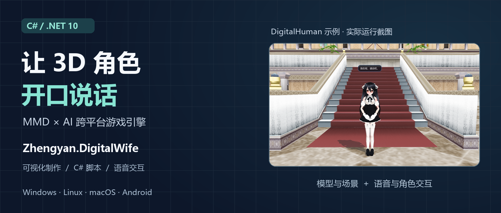
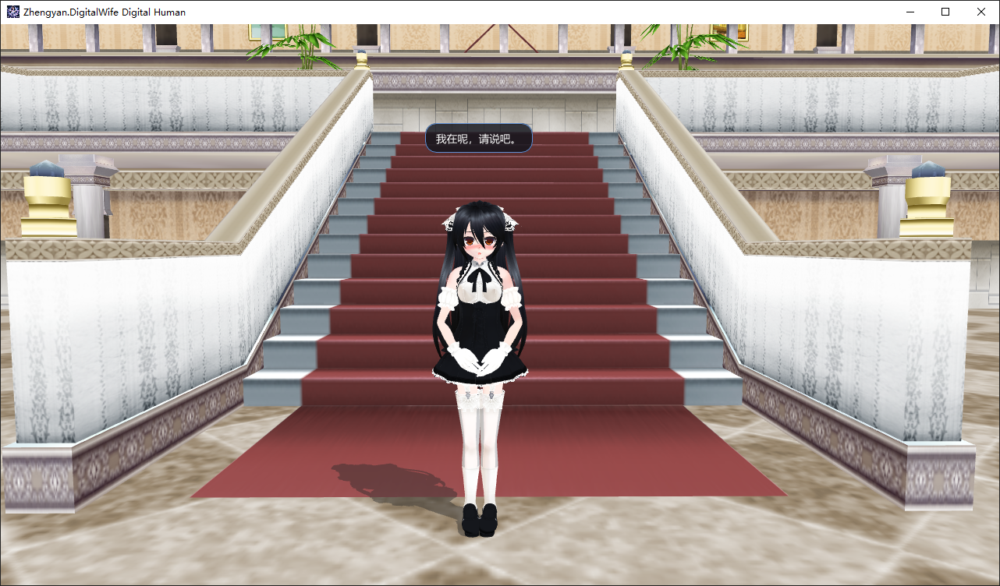
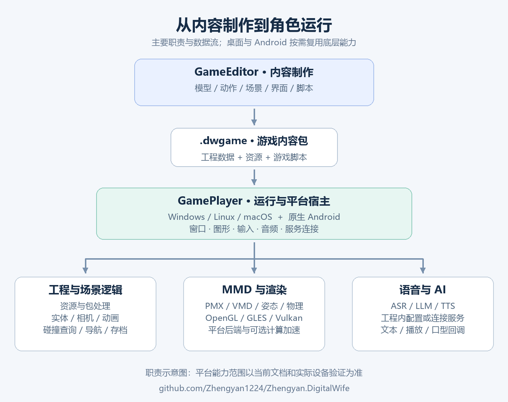

# 用 C# 做一个会说话的 3D 角色：我的 MMD × AI 跨平台游戏引擎



导入一个 MMD 角色，给它加上动作和表情；再放进一个场景，让玩家点击按钮、开口说话，角色用语音回应；最后把作品打包，在电脑或 Android 手机上运行。

这就是我正在研发的 **Zhengyan.DigitalWife** 想连接起来的制作流程。

它是一个用 **C# / .NET 10** 开发的轻量游戏引擎与制作工具，面向 MMD 互动场景、AI 数字人和轻量游戏。项目包含可视化编辑器、桌面播放器、原生 Android 播放器，以及可单独使用的模型、渲染、音频和 AI 模块。

源码已经放在 [GitHub：Zhengyan1224/Zhengyan.DigitalWife](https://github.com/Zhengyan1224/Zhengyan.DigitalWife)。这篇文章先展示它能做什么，再聊聊背后的实现，以及怎样开始体验。

## 从一个角色，到一个可交互的作品

一个 3D 角色要真正参与交互，需要模型、动画、输入、界面、声音和游戏规则相互配合。加入 AI 后，还要处理语音识别、流式回复、语音播放与角色口型。

我希望这些能力能在同一个工程里组织起来：用编辑器摆场景，用脚本定义行为，再交给播放器运行。

可以先从一个很小的作品开始：角色站在教室里循环播放动作，玩家点击按钮，角色说出一段台词。下一步再加入语音输入、AI 对话或场景切换，逐步扩展成自己的应用。

下面是仓库中 **DigitalHuman 独立示例**的运行截图，展示角色、场景和唤醒后的文字提示：



这张图来自连接 RealtimeVoice 服务的数字人前端示例。可编辑游戏中的对话能力由 GameEditor / GamePlayer 提供，二者共享部分底层能力，运行入口各有分工。

## 制作端：把模型、场景和脚本放进同一个工程

项目的可视化制作入口叫 **GameEditor**。

它提供工程、资源、场景层级、属性和预览等面板。制作时，可以导入 PMX 模型和 VMD 动作，调整角色位置、相机与灯光，再添加按钮、文本框、对话气泡和游戏脚本。

如果第一次接触 MMD，可以先记住两个文件格式：**PMX 是模型，VMD 是动作**。导入模型时，需要保留它引用的贴图文件。

编辑器目前可以组织的内容包括：

- **角色表现**：模型、动作层、表情、服装绑定、PMX 物理和口型。
- **场景画面**：天空盒、灯光、阴影、水面、粒子、镜面、多相机和 Render Texture。
- **游戏交互**：C# 脚本、GUI、触摸、碰撞查询、导航、存档与场景切换。
- **AI 配置**：语音识别、TTS、LLM、RealtimeVoice，以及可选的 Skills 和长期记忆。

工程保存在普通目录中，核心是 JSON 配置、资源和脚本：

```text
MyGame/
  game.project.json   工程设置与场景入口
  scenes/             场景数据
  assets/             模型、贴图、动作、音频等
  scripts/            游戏逻辑
  skills/             可选 AI 工具说明与资源
```

这样的组织方式也方便开发者直接查看配置、比较版本变化，或者研究编辑器如何把制作内容交给运行时。[GameEditor 文档](https://github.com/Zhengyan1224/Zhengyan.DigitalWife/blob/main/src/Zhengyan.DigitalWife.GameEditor/README.md)里有完整的第一次制作流程。

## 运行端：同一个内容包，交给对应平台的播放器

制作完成后，可以在编辑器的 `Project → Package / Publish` 中导出 **`.dwgame` 游戏包**，支持加密、分片和 C# 脚本预编译。

这里需要区分两个东西：游戏包保存你的内容；GamePlayer 负责运行内容。交付作品时，需要一起提供适合目标平台的播放器。

桌面 GamePlayer 面向 **Windows、Linux 和 macOS**。Android 端是原生应用，安装播放器 APK 后，通过系统文件选择器打开游戏包。

跨平台工作的重点，是尽量复用工程格式、场景逻辑、模型求值和脚本能力，再为窗口、输入、图形与音频提供平台适配。当前主要差异如下：

| 能力 | 桌面端 | Android 端 |
| --- | --- | --- |
| C# 游戏脚本 | 支持 | 支持，使用 Android 脚本契约 |
| Python 游戏脚本 | 使用本机 Python | 暂不支持 |
| 图形后端 | OpenGL / Vulkan，取决于平台与驱动 | OpenGL ES / Vulkan |
| 本地语音 | 工程配置的 Whisper / Sherpa 等能力 | 工程内 Sherpa CPU 模型 |
| 桌面精灵 | 透明窗口、拖动、点击穿透等平台实现 | 不提供桌面窗口功能 |

**同一个包能跨平台加载，具体功能仍需按平台验证。** 比如自定义 shader、音频行为、软键盘、透明窗口和 GPU 性能，都可能受到系统与设备影响。Android 的当前实现范围记录在[能力对照文档](https://github.com/Zhengyan1224/Zhengyan.DigitalWife/blob/main/docs/android-render-parity.md)中。

## 技术设计一：让 MMD 角色参与游戏循环

MMD 运行时处理 PMX / VMD 解析、骨骼变换、Morph 表情、IK、动作插值、蒙皮，以及 PMX 刚体与关节物理。

在游戏里，这些能力会随每一帧推进：动作更新姿态，姿态改变角色形状，渲染层再把结果画出来。多动作层让角色能够组合动作；语音播放则可以驱动模型的嘴部 Morph。

仓库里还有一个带控制面板的 **MmdDemo**，可以查看动作播放、模型绑定、水面和粒子等效果：


这张图是模型调试示例，适合研究底层组件；实际制作游戏可以从 GameEditor 开始。

图形层目前支持 OpenGL 与 Vulkan 两条路径。窗口渲染、离屏目标、纹理和模型绘制通过接口组织，让场景组件能够把具体 GPU 操作交给对应后端。

例如，Render Texture 可以用于镜面、角色预览或另一台相机的画面。场景组件请求离屏目标，后端负责创建和使用自己的图形资源。

Vulkan 路径还提供可选的 Compute 蒙皮：把计算结果写入 GPU 顶点缓冲，再供绘制使用，减少正常路径中的顶点回读与重复上传。计算加速存在 CPU 回退；实际收益取决于模型复杂度、驱动和设备。[渲染后端设计](https://github.com/Zhengyan1224/Zhengyan.DigitalWife/blob/main/docs/rendering-backends.md)记录了这些接口和资源流向。

## 技术设计二：用 C# 定义角色行为

编辑器负责搭建内容，脚本负责定义规则。C# 游戏脚本使用 `.csx` 文件，通过 `Entity`、`Scene`、`Input` 等对象访问角色、场景与输入。

比如，把下面的脚本绑定到一个实体，就可以让它在每帧缓慢旋转：

```csharp
if (IsUpdate)
{
    Entity.RotateY(20.0f * (float)DeltaSeconds);
}
```

`IsUpdate` 表示当前是更新事件；`DeltaSeconds` 是这一帧经过的时间。乘上时间后，旋转速度按“每秒多少度”控制。

同样的事件方式也用于 GUI、语音和 LLM 回调。导出时，编辑器可以分别预编译桌面与 Android 的 C# 脚本，提前发现目标平台的接口问题，并减少运行时首次编译的工作。

Android 脚本还有一层独立的强类型契约，让桌面编辑器能提前编译面向手机的逻辑，手机宿主再提供对应实现。动态脚本调用的成员还需要在 Release 裁剪后保留，这也是项目回归验证的一部分。

从开发者视角看，这些设计把两个问题分开处理：游戏作者编写角色行为，引擎负责把行为连接到各平台的运行能力。

## 技术设计三：把 AI 对话接进角色和场景

一轮语音交互可以按下面的流程理解：

```text
玩家说话 → ASR 转成文字 → LLM 生成回复 → TTS 合成语音
                                            ↓
                              显示气泡、播放声音、驱动口型
```

项目提供两种组织方式。

**第一种是在游戏工程里分别配置 ASR、LLM 和 TTS。** 脚本通过 `Scene.Asr`、`Scene.Llm` 和 `Entity.Speak` 编排流程。LLM 使用可配置的兼容接口，服务地址、模型名称和鉴权信息由开发者提供。

Android 的本地 ASR / TTS 使用工程内的 Sherpa CPU 模型，录音与播放接入原生 AudioRecord / AudioTrack。模型资源齐全时，这部分语音处理在本机完成；LLM 推理是独立环节，需要可访问的配置服务。

**第二种是连接 RealtimeVoice 服务。** 由另一进程或机器负责 ASR、LLM 和 TTS，播放器负责采音、发送请求、显示文本和播放回复。这种拆分适合把较重的推理工作放到服务器。

两种方式都需要考虑交互时序：玩家是否说完、回复如何逐段显示、何时开始播放、切换场景后如何取消旧请求，以及音频结束时怎样通知脚本。

下面是一段简化的游戏脚本，展示“点击按钮 → 请求台词 → 显示回复 → 角色说话”的连接方式。使用前，需要在工程里启用并配置 LLM / TTS，创建名为 `LLM Output` 的文本控件，并让按钮的 `clicked` 事件指向该角色脚本。

```csharp
if (IsGuiEvent && GuiEventName == "clicked")
{
    Scene.Llm.StartChat(
        Entity,
        "用一句话欢迎玩家进入教室。",
        systemPrompt: "你是游戏里的向导，语气自然，回答简短。",
        onCompletedCallback: "welcome_done",
        onErrorCallback: "welcome_error");
}

if (IsLlmEvent && LlmCallbackName == "welcome_done")
{
    Scene.GetGuiControl("LLM Output")?.SetValue(LlmText);
    Entity.Speak(LlmText);
}

if (IsLlmEvent && LlmCallbackName == "welcome_error")
{
    Console.Error.WriteLine(LlmError);
}
```

`StartChat` 在后台发起请求，结果通过脚本事件返回，适合把网络等待与游戏更新分开。需要逐段显示文本时，还可以处理 delta 回调；想让角色读取游戏状态，可以使用脚本工具调用。

Skills 和长期记忆是独立可选能力：前者组织工具说明与资源，后者把信息保存到玩家存档目录。这些能力为角色读取状态、调用工具和跨会话保留信息提供接口，具体行为由工程配置和脚本设计决定。[LLM 脚本文档](https://github.com/Zhengyan1224/Zhengyan.DigitalWife/blob/main/src/Zhengyan.DigitalWife.GameEditor/api_docs/25-llm.md)提供了流式输出和工具调用示例。

## 几个模块如何配合

下图展示的是项目主要职责和数据流；桌面与 Android 宿主按各自需要复用底层模块。



主要技术选择包括 **.NET 10、Roslyn、ImGui.NET、Silk.NET、Veldrid、Bullet、Sherpa 和 Whisper**。项目中的工作，是把这些库接入一致的工程、生命周期和运行入口，处理平台适配、资源释放与回调时序。

比如，共享工程格式层承担 JSON、资源路径和游戏包处理；MMD 层承担模型与姿态求值；运行层组织场景、实体和服务；平台宿主处理窗口、触摸、音频和图形环境。

这也让项目有两种使用方式：可以直接使用编辑器和播放器制作作品，也可以从示例入手，单独研究或复用其中的模型、语音和渲染模块。

## 从源码开始体验

先安装 **Git 和 .NET 10 SDK**，再获取仓库：

```bash
git clone https://github.com/Zhengyan1224/Zhengyan.DigitalWife.git
cd Zhengyan.DigitalWife
dotnet --version
```

确认选中的 SDK 是 `10.x`。首次构建需要下载 NuGet 依赖，并复制示例资源。

如果想先看角色和场景，可以运行 QuickStart：

```bash
dotnet run --project samples/Zhengyan.DigitalWife.Samples.MmdQuickStart
```

这个示例用 C# 直接组织角色、动作、场景、水面和背景音乐，**无需先部署 AI 服务或下载语音模型**。需要可用的图形驱动，Linux 还需按主 README 准备系统运行库。

如果想开始制作自己的作品，运行编辑器：

```bash
dotnet run --project src/Zhengyan.DigitalWife.GameEditor
```

在 Project 面板选择自己的工程目录，创建工程，导入模型和动作，保存后用播放器验证。下面的 `MyGame` 要替换为实际工程目录：

```bash
dotnet run --project src/Zhengyan.DigitalWife.GamePlayer -- "./MyGame"
```

普通场景运行稳定后，再加入语音和 AI。手机端则按 [Android 编译与运行指南](https://github.com/Zhengyan1224/Zhengyan.DigitalWife/blob/main/src/Zhengyan.DigitalWife.GamePlayer.Android/README.md)准备 SDK、JDK 和 workload，构建播放器 APK。

## 当前适合怎样使用

项目仍在持续研发，适合用来学习 C# 图形与游戏运行时、制作 MMD 互动作品、验证 AI NPC 或数字人原型，也适合研究桌面与 Android 的代码复用。

有几个边界会影响实际作品：Android 暂不支持 Python 脚本；不同图形后端的自定义 shader 需要分别适配；Linux 桌面精灵的点击穿透目前依赖 X11；语音体验取决于模型、麦克风、设备性能与服务响应。

这些工程问题也在推动项目的回归验证：模型姿态、游戏包、脚本编译、触摸事件、LLM 回调和 Android Release 裁剪都有对应检查。目标是让一次修改能沿着制作、导出和运行流程验证，而每个作品的最终表现仍需要在目标设备上确认。

示例素材、模型和第三方组件的授权各自独立，发布作品时需要核对所使用的资源。

## 欢迎来一起做有意思的角色

如果你喜欢 C#、MMD、游戏工具或 AI 交互，欢迎来看看这个项目。

可以先跑一个 Demo，换上自己的模型，做一个按钮、一段台词，或者一小段游戏逻辑。实际使用中的问题和作品反馈，会帮助项目继续完善。

仓库地址：**[Zhengyan1224/Zhengyan.DigitalWife](https://github.com/Zhengyan1224/Zhengyan.DigitalWife)**

欢迎 Star、提交 Issue，或者通过 PR 参与改进。希望这个项目能让更多人把喜欢的角色，做成可以互动、可以分享的作品。
