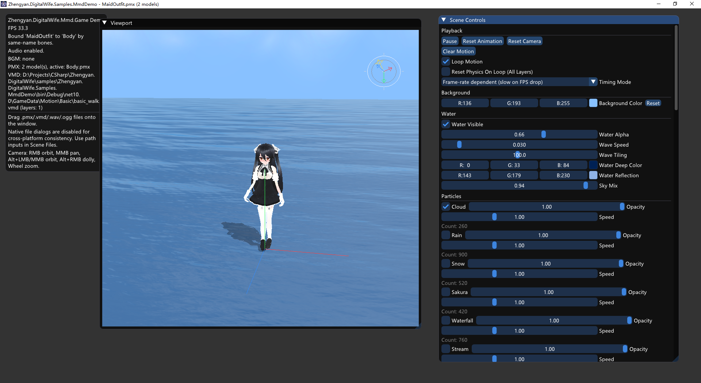

# MmdDemo：带控制面板的 MMD 调试场景

这是展示与调试 Mmd.Game 的桌面程序。你可以查看模型、VMD、多动作层、口型、粒子、水面和音频，适合验证新模型或引擎改动。



它是代码级示例，不是 GameEditor，也不加载 .dwgame。制作工程请看[编辑器](../../src/Zhengyan.DigitalWife.GameEditor/README.md)。

## 运行

需要 .NET 10 SDK 和可用图形设备，在仓库根目录：

```text
dotnet run --project samples/Zhengyan.DigitalWife.Samples.MmdDemo
```

使用自己的模型和动作：

```text
dotnet run --project samples/Zhengyan.DigitalWife.Samples.MmdDemo -- "D:/Models/character.pmx" "D:/Motions/walk.vmd"
```

路径是示例，需要替换。第三个参数可指定口型字典目录。PMX、VMD 和可选字典应实际存在。

## 可以检查的内容

- ImGui 模型/动作控制面板与文件拖拽。
- PMX / VMD / WAV / OGG 资源加载。
- 多模型绑定、动作层权重和播放控制。
- 口型与中文/日文字典。
- 粒子、水面效果和背景音乐。

默认资源包含 Body.pmx、basic_walk.vmd 与 SpeechLipSyncDictionaries。构建会复制素材与引擎资源；独立运行时保留这些目录。

口型字典是驱动 Morph 的数据，不是完整 ASR 或 TTS 模型。跑此场景不需要部署 LLM。

## 调试与源码入口

[Program.cs](Program.cs)解析参数，[DemoGame.cs](DemoGame.cs)组织场景，[DemoOverlayComponent.cs](DemoOverlayComponent.cs)实现控制面板。

看到某个模型效果异常时，先查看模型路径、动作兼容、材质与物理设置；自定义 shader 还需区分后端。

- [项目总览](../../README.md)
- [更简单的 QuickStart](../Zhengyan.DigitalWife.Samples.MmdQuickStart/README.md)
- [渲染后端](../../docs/rendering-backends.md)
